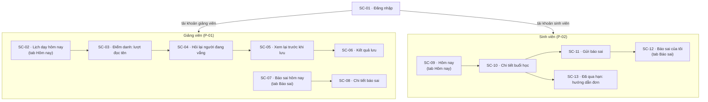
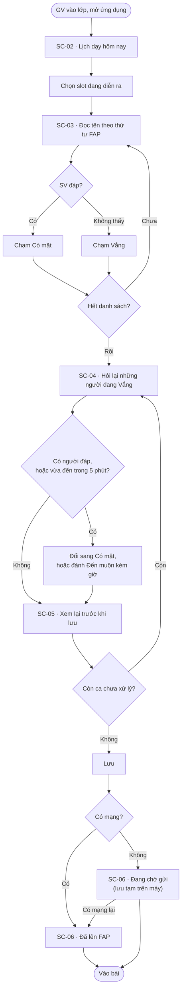
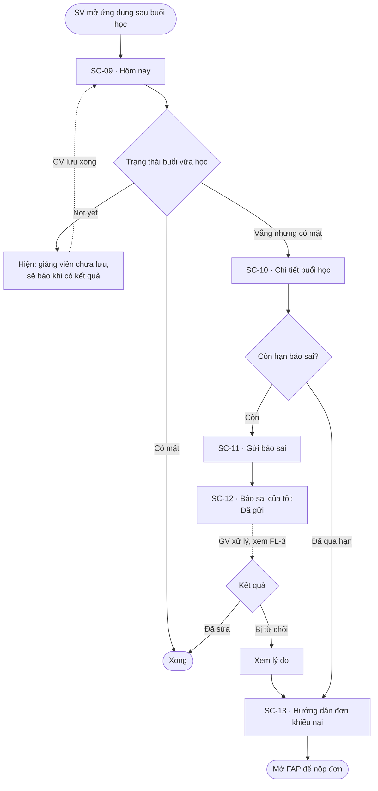
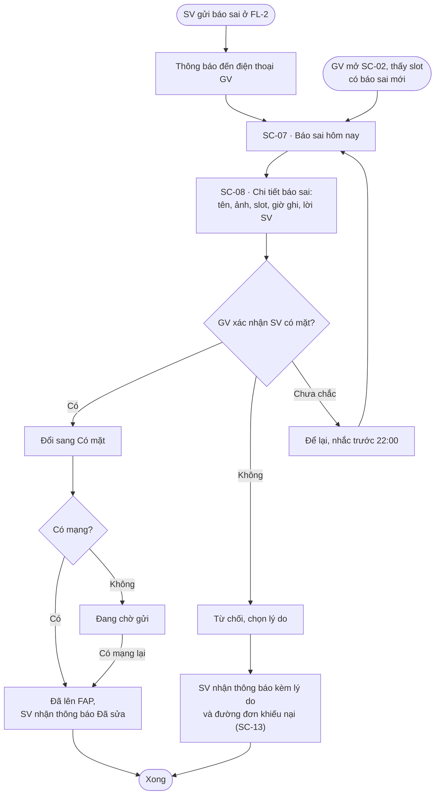

# Kiến trúc thông tin và user flow

| Thuộc tính | Giá trị |
|---|---|
| Mã tài liệu | UX-FLOW |
| Trạng thái | Chờ duyệt |
| Đầu vào | UX-PERSONA (`ux/persona.md`), RES-AFFINITY-v2, RES-DESK-FAP |
| Quyết định liên quan | D-02, D-12, D-17 |

**Giả định nền (Assumed, để trong phạm vi bài lab):** ứng dụng đọc lịch dạy và danh sách lớp từ FAP, và ghi trạng thái điểm danh về FAP. FAP vẫn là nơi lưu kết quả chính thức. Trạng thái dùng đúng tên của FAP: **Attended**, **Absent**, **Not yet** (D-12, H36). Trên giao diện tiếng Việt, hai trạng thái đầu hiện là "Có mặt" và "Vắng", kèm chữ gốc của FAP ở nơi cần đối chiếu.

**Mốc báo sai (RB-4, Desk V01, V13):** với môn thường, sinh viên báo giảng viên trước 23:59 ngày có slot. Với môn LUK, hạn là 2 ngày. Quá mốc thì đường duy nhất là "Đơn khiếu nại điểm danh" trên FAP, gửi phòng QLĐT. Ứng dụng không làm lại quy trình đơn, chỉ dẫn sang FAP.

---

## 1. Kiến trúc thông tin

Hai vai trò dùng chung một ứng dụng, tách theo tài khoản sau khi đăng nhập. Mỗi vai trò có 2 tab.

---

## 2. Danh sách màn hình

13 màn hình, nằm trong khoảng 12–15 của D-02. Màn nào cũng thuộc ít nhất một flow.

| Mã | Màn hình | Vai trò | Flow | Nhu cầu | Trạng thái cần thiết kế |
|---|---|---|---|---|---|
| SC-01 | Đăng nhập | Cả hai | FL-1, FL-2 | — | Mặc định, đang tải, lỗi tài khoản không thuộc FPTU |
| SC-02 | Lịch dạy hôm nay | GV | FL-1, FL-3 | N-04, N-11 | Slot chưa điểm danh, đã lưu, đang chờ gửi, có báo sai mới |
| SC-03 | Điểm danh: lượt đọc tên | GV | FL-1 | N-04 | Dòng chưa đánh, Có mặt, Vắng, tên trùng hoặc gần trùng |
| SC-04 | Hỏi lại người đang vắng | GV | FL-1 | N-04, N-03 | Danh sách vắng, đổi sang Có mặt, đánh Đến muộn kèm giờ |
| SC-05 | Xem lại trước khi lưu | GV | FL-1 | N-04, N-03 | Đủ, còn ca chưa xử lý |
| SC-06 | Kết quả lưu | GV | FL-1 | N-11 | Đã lên FAP, đang chờ gửi (mất mạng), gửi lỗi |
| SC-07 | Báo sai hôm nay | GV | FL-3 | N-01 | Có báo mới, đã xử lý hết, trống |
| SC-08 | Chi tiết báo sai | GV | FL-3 | N-01 | Chờ xử lý, đã sửa, đã từ chối kèm lý do |
| SC-09 | Hôm nay (sinh viên) | SV | FL-2 | N-01, N-10 | Not yet, Có mặt, Vắng, đã có báo sai |
| SC-10 | Chi tiết buổi học | SV | FL-2 | N-01 | Còn hạn báo sai, đã qua hạn |
| SC-11 | Gửi báo sai | SV | FL-2 | N-01 | Nhập, đang gửi, lỗi mạng |
| SC-12 | Báo sai của tôi | SV | FL-2, FL-3 | N-01 | Đã gửi, giảng viên đã xem, đã sửa, bị từ chối |
| SC-13 | Đã qua hạn: hướng dẫn đơn | SV | FL-2 | N-06 | Một trạng thái |

**Ngoài phạm vi, đưa vào roadmap:** tỷ lệ vắng theo môn (N-09, có thể FAP đã đáp ứng: Desk V04, V14), đơn miễn điểm danh (N-12), vai trò lớp trưởng (N-13), quản trị cho phòng QLĐT.

---

## 3. Flow

Ba flow được chấm điểm. FL-3 là flow lỗi và phục hồi chính; FL-1 và FL-2 cũng có nhánh lỗi riêng.

### FL-1 · Điểm danh một slot (P-01, kịch bản K1)

Mục tiêu: lưu xong điểm danh đúng trong vài phút đầu slot (TC-1). Nhánh lỗi: mất mạng lúc lưu.

### FL-2 · Sinh viên kiểm tra và báo sai (P-02, kịch bản K3 và K4)

Mục tiêu: biết trạng thái buổi vừa học và báo sai trước hạn (TC-4, TC-5, TC-6). Nhánh lỗi: đã qua hạn.

### FL-3 · Giảng viên xử lý báo sai trong ngày (P-01, kịch bản K2) — flow lỗi và phục hồi

Mục tiêu: sửa đúng một ca bị ghi sai trước khi hết ngày (TC-2). Đây là đường phục hồi cho lỗi ở khâu ghi (F-01, F-04, F-10a).

---

## 4. Truy vết

| Flow | Persona | Nhu cầu | Kịch bản | Tiêu chí thành công | Màn hình |
|---|---|---|---|---|---|
| FL-1 | P-01 | N-04, N-03, N-11 | K1 | TC-1, TC-3 | SC-01..SC-06 |
| FL-2 | P-02 | N-01, N-06, N-10 | K3, K4 | TC-4, TC-5, TC-6 | SC-01, SC-09..SC-13 |
| FL-3 | P-01 (P-02 khởi động) | N-01 | K2 | TC-2 | SC-02, SC-07, SC-08, SC-12, SC-13 |

## 5. Câu hỏi mở cho thiết kế

- **Ảnh sinh viên ở SC-08:** giúp giảng viên thỉnh giảng nhận mặt (R03), nhưng chưa biết FAP có cung cấp ảnh cho giảng viên không (Assumed).
- **Mốc nhắc 22:00 ở FL-3:** chọn trước 23:59 để còn thời gian sửa; con số là Assumed.
- **Giảng viên dùng điện thoại hay laptop:** rủi ro lớn nhất của P-01 (`ux/persona.md`, mục 6). Nếu giảng viên thật nói họ chỉ dùng laptop, FL-1 vẫn giữ nguyên logic, nhưng lý do chọn mobile phải chuyển sang FL-3 (sửa trong giờ nghỉ, không mở laptop).
