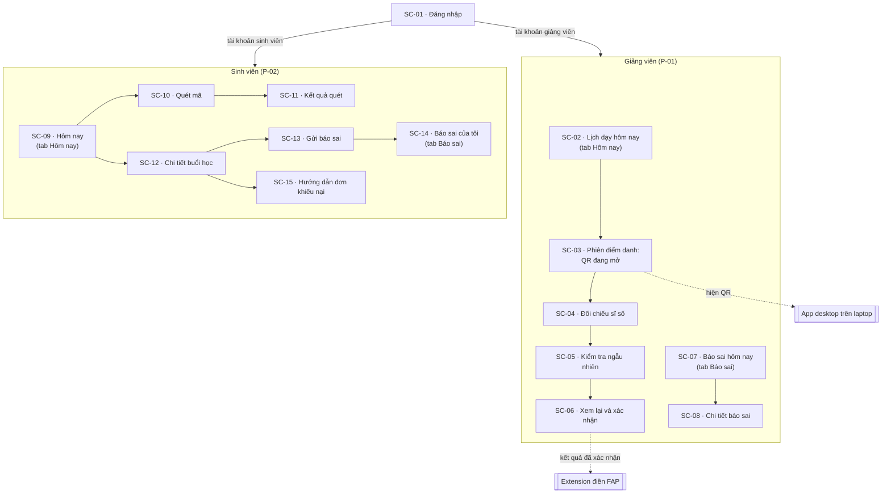
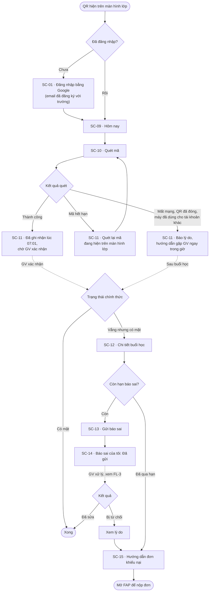
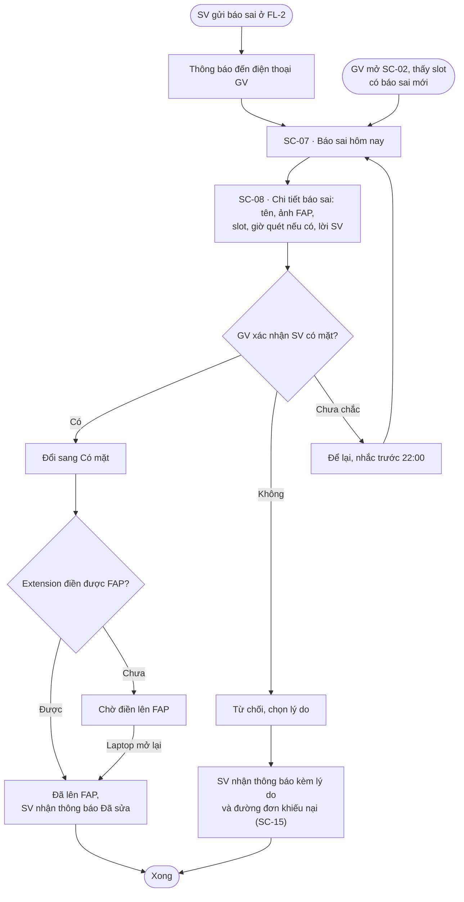

# Kiến trúc thông tin và user flow

| Thuộc tính | Giá trị |
|---|---|
| Mã tài liệu | UX-FLOW |
| Phiên bản | v2 (14/10/2026): chuyển FL-1 sang QR theo D-19. Bản đọc tên là v1, xem lịch sử git |
| Trạng thái | Đã duyệt (thien, 15/10/2026) |
| Đầu vào | UX-PERSONA (`ux/persona.md`), UX-INTEGRITY (`ux/attendance-integrity.md`), RES-AFFINITY-v2, RES-DESK-FAP, RES-DESK-QR |
| Quyết định liên quan | D-02, D-12, D-17, D-18, D-19, D-21 (chốt B: cả 4 lớp) |

**Giả định nền.** Ứng dụng đọc lịch dạy và danh sách lớp, kể cả ảnh sinh viên, từ FAP. Ứng dụng không ghi thẳng vào FAP. Extension trên laptop của giảng viên tự điền trang điểm danh của FAP từ kết quả đã xác nhận (D-18). FAP vẫn là nơi lưu kết quả chính thức. Trạng thái dùng đúng chữ của FAP mới: **Có mặt**, **Vắng**, **Chưa điểm danh** (D-12, O-02).

**Cách điểm danh (D-19).** Giảng viên mở phiên, QR hiện trên màn hình phòng (đa số là TV màn hình lớn, số ít máy chiếu), cả lớp quét cùng lúc, không đọc tên. Giảng viên có thể mở phiên từ điện thoại khi chưa vào lớp. Trước khi kết quả được điền lên FAP, giảng viên đối chiếu sĩ số và kiểm tra ngẫu nhiên (UX-INTEGRITY, lớp L3 và L4).

**Mốc báo sai (RB-4, Desk V01, V13).** Với môn thường, sinh viên báo giảng viên trước 23:59 ngày có slot; với môn LUK, hạn là 2 ngày. Quá mốc thì đường duy nhất là “Đơn khiếu nại điểm danh” trên FAP, gửi phòng QLĐT. Ứng dụng chỉ dẫn sang FAP, không làm lại quy trình đơn.

**Vì sao vẫn cần báo sai khi đã có QR.** QR không loại hết lỗi ghi. Sinh viên có mặt vẫn có thể bị ghi Vắng khi điện thoại hết pin hoặc mất 4G lúc quét, khi đến sau lúc QR đóng mà giảng viên quên ghi tay, hoặc khi bị chọn kiểm tra ngẫu nhiên mà giảng viên bấm nhầm. FL-3 là đường sửa cho những ca này.

---

## 1. Kiến trúc thông tin

Hai vai trò dùng chung một ứng dụng, tách theo tài khoản sau khi đăng nhập. Mỗi vai trò có 2 tab. App desktop trên laptop và extension nằm ngoài phạm vi thiết kế của bài lab; sơ đồ chỉ ghi chúng ở chỗ ứng dụng di động tương tác với chúng.

---

## 2. Danh sách màn hình

15 màn hình, đúng mức trần 12–15 của D-02. Màn nào cũng thuộc ít nhất một flow.

| Mã | Màn hình | Vai trò | Flow | Nhu cầu | Trạng thái cần thiết kế |
|---|---|---|---|---|---|
| SC-01 | Đăng nhập | Cả hai | FL-1, FL-2 | — | Mặc định, đang tải, lỗi email chưa đăng ký với trường (sinh viên các khóa mới đăng nhập FAP bằng Gmail cá nhân, CR-41) |
| SC-02 | Lịch dạy hôm nay | GV | FL-1, FL-3 | N-04, N-11 | Slot sắp tới (nút “Mở điểm danh”), đang mở, chờ xác nhận, chờ điền lên FAP, đã lên FAP, có báo sai mới |
| SC-03 | Phiên điểm danh: QR đang mở | GV | FL-1 | N-04 | Mở tại lớp, **mở từ xa** (mã chỉ hiện trên màn hình phòng P.205, D-24), laptop chưa kết nối, sắp đóng, đã đóng; dòng có cờ “Cùng thiết bị” |
| SC-04 | Đối chiếu sĩ số | GV | FL-1 | N-04 | Khớp, số quét lớn hơn số người (chỉ ra người quét cuối, quét sát lúc mã đổi), số quét nhỏ hơn số người |
| SC-05 | Kiểm tra ngẫu nhiên | GV | FL-1 | N-04 | 3 thẻ có ảnh FAP; Đúng người, Không có mặt |
| SC-06 | Xem lại và xác nhận | GV | FL-1 | N-03, N-11 | Ghi tay người đến muộn kèm giờ, còn cờ chưa xử lý, đã xác nhận: Chờ điền lên FAP, Đã lên FAP, extension lỗi |
| SC-07 | Báo sai hôm nay | GV | FL-3 | N-01 | Có báo mới, đã xử lý hết, trống |
| SC-08 | Chi tiết báo sai | GV | FL-3 | N-01 | Chờ xử lý, đã sửa, đã từ chối kèm lý do |
| SC-09 | Hôm nay (sinh viên) | SV | FL-2 | N-01, N-10 | Chưa điểm danh, đã quét (chờ xác nhận), Có mặt, Vắng, đã có báo sai |
| SC-10 | Quét mã | SV | FL-2 | N-01 | Camera, xin quyền camera, bị từ chối quyền; dòng nhắc “Điểm danh hộ là gian lận học tập” |
| SC-11 | Kết quả quét | SV | FL-2 | N-01 | Thành công kèm giờ; mã hết hạn; đã quét rồi; không có trong lớp; máy đã dùng cho tài khoản khác; QR đã đóng; mất mạng |
| SC-12 | Chi tiết buổi học | SV | FL-2 | N-01 | Còn hạn báo sai, đã qua hạn |
| SC-13 | Gửi báo sai | SV | FL-2 | N-01 | Nhập, đang gửi, lỗi mạng |
| SC-14 | Báo sai của tôi | SV | FL-2, FL-3 | N-01 | Đã gửi, giảng viên đã xem, đã sửa, bị từ chối |
| SC-15 | Hướng dẫn đơn khiếu nại | SV | FL-2 | N-06 | Một trạng thái |

**So với v1:** bỏ “lượt đọc tên” và “hỏi lại người đang vắng”; gộp “xem lại” với “kết quả lưu” thành SC-06; thêm đối chiếu sĩ số (SC-04), kiểm tra ngẫu nhiên (SC-05), quét mã (SC-10) và kết quả quét (SC-11).

**Ngoài phạm vi, đưa vào roadmap:** giao diện app desktop và extension; tỷ lệ vắng theo môn (N-09, có thể FAP đã đáp ứng: Desk V04, V14); đơn miễn điểm danh (N-12); vai trò lớp trưởng (N-13); quản trị cho phòng QLĐT; BLE beacon (UX-INTEGRITY mục 4).

**Ngoài phạm vi của bản thiết kế, có lý do:**
- *Hồ sơ, cài đặt, đăng xuất:* chưa có menu tài khoản. Avatar tài khoản do Stitch tự thêm đã bị bỏ vì không có chức năng trong luồng (CR-08, CR-14). Đăng nhập bằng tài khoản Google của trường (SC-01) nên không có mật khẩu riêng để quản lý; bản dựng thật cần ít nhất một mục Đăng xuất ở app bar của SC-02 và SC-09.
- *Trung tâm thông báo và push:* chỉ thiết kế huy hiệu trên tab (CMP-04) và nội dung thông báo trong FL-3. Danh sách thông báo riêng không cần cho ba flow chấm điểm.
- *Onboarding:* không có. Ứng dụng nội bộ, người dùng đăng nhập bằng tài khoản trường và đã quen FAP; hướng dẫn nằm ngay tại chỗ cần (dòng nhắc ở SC-03, SC-10, sheet “Không quét được?”).

---

## 3. Flow

Ba flow được chấm điểm. Flow nào cũng có nhánh lỗi. FL-3 là flow phục hồi chính.

### FL-1 · Điểm danh một slot bằng QR (P-01, kịch bản K1 và K1b)

Mục tiêu: từ lúc QR đóng tới lúc xác nhận xong trong ≤ 2 phút 30 giây (D-29), không sai lệch, và phát hiện được quét hộ (TC-1, TC-3, TC-7). Nhánh lỗi: số quét không khớp số người; laptop chưa kết nối; extension chưa điền được. Nhánh K1b (D-24): mã chỉ hiện trên trang web “Màn hình phòng P.205” chạy trên TV (hoặc máy chiếu) của phòng, không hiện trên điện thoại của GV, để người ở ngoài phòng không thấy mã.

```mermaid
flowchart TD
    A([Tới giờ slot]) --> A1{"Đã đăng nhập?"}
    A1 -->|Chưa| S1["SC-01 · Đăng nhập bằng Google<br/>(tài khoản giảng viên)"]
    S1 --> B
    A1 -->|Rồi| B["SC-02 · Lịch dạy hôm nay"]
    B --> C{"GV đang ở trong lớp?"}
    C -->|Có| D["Mở điểm danh"]
    C -->|Không, K1b| D2["Mở điểm danh từ xa<br/>(phiên gắn nhãn Mở từ xa)"]
    D --> E{"Laptop trong phòng<br/>đã kết nối?"}
    D2 --> E2{"Màn hình lớp P.205<br/>(TV hoặc máy chiếu) đang mở trang QR?"}
    E2 -->|Rồi| F2["SC-03 · Mở từ xa: mã chỉ hiện trên màn hình phòng P.205,<br/>điện thoại GV chỉ đếm số đã quét (D-24)"]
    E2 -->|Chưa| E3["Không mở từ xa được,<br/>mở khi GV vào lớp"]
    E3 -.-> D
    F2 --> G
    E -->|Chưa| E1["SC-03 · Báo laptop chưa kết nối,<br/>hiện QR trên điện thoại để chiếu tạm"]
    E -->|Rồi| F["SC-03 · QR hiện trên màn hình lớp,<br/>đếm số đã quét"]
    E1 --> F
    F --> G["QR tự đóng lúc giờ vào slot + 5 phút (D-28),<br/>hoặc GV bấm Đóng QR"]
    G --> H{"GV đã ở trong lớp?"}
    H -->|Chưa| H1["Kết quả giữ ở Chờ GV xác nhận,<br/>không được điền lên FAP"]
    H1 -.->|GV vào lớp| I
    H -->|Rồi| I["SC-04 · Đếm người trong phòng,<br/>nhập sĩ số"]
    I --> J{"Số quét = số người?"}
    J -->|Lớn hơn| J1["Hiện người quét cuối,<br/>quét sát lúc mã đổi, cờ Cùng thiết bị"]
    J1 --> J2["GV gọi tên những người này,<br/>đổi người không có mặt sang Vắng"]
    J2 --> K
    J -->|Nhỏ hơn| J3["Có người chưa quét được:<br/>ghi tay ở SC-06"]
    J3 --> K
    J -->|Khớp| K["SC-05 · Kiểm tra ngẫu nhiên 3 SV<br/>bằng ảnh FAP"]
    K --> L{"Cả 3 đúng người?"}
    L -->|Không| L1["Đổi sang Vắng, ghi chú,<br/>kiểm thêm 3 người"]
    L1 --> M
    L -->|Có| M["SC-06 · Ghi tay người đến muộn<br/>kèm giờ, xem lại"]
    M --> N["Xác nhận"]
    N --> O{"Extension trên laptop<br/>điền được FAP?"}
    O -->|Được| P["SC-06 · Đã lên FAP"]
    O -->|Chưa: laptop tắt,<br/>FAP lỗi| Q["SC-06 · Chờ điền lên FAP,<br/>nhắc mở laptop"]
    Q -.->|Laptop mở lại| P
    P --> R([Vào bài])
    Q --> R
```

### FL-2 · Sinh viên quét mã, kiểm tra và báo sai (P-02, kịch bản K3, K4 và K5)

Mục tiêu: biết ngay mình đã được ghi nhận chưa, và báo sai trước hạn nếu cần (TC-4, TC-5, TC-6). Nhánh lỗi: mã hết hạn, QR đã đóng, đã qua hạn báo sai.

### FL-3 · Giảng viên xử lý báo sai trong ngày (P-01, kịch bản K2): flow lỗi và phục hồi

Mục tiêu: sửa đúng một ca bị ghi sai trước khi hết ngày (TC-2). Đây là đường phục hồi cho những ca QR không bắt được (xem “Vì sao vẫn cần báo sai” ở đầu tài liệu) và cho lỗi ở khâu ghi (F-01, F-04, F-10a).

---

## 4. Truy vết

| Flow | Persona | Nhu cầu | Kịch bản | Tiêu chí thành công | Màn hình |
|---|---|---|---|---|---|
| FL-1 | P-01 | N-04, N-03, N-11 | K1, K1b | TC-1, TC-3, TC-7 | SC-01..SC-06 |
| FL-2 | P-02 | N-01, N-06, N-10 | K3, K4, K5 | TC-4, TC-5, TC-6 | SC-01, SC-09..SC-15 |
| FL-3 | P-01 (P-02 khởi động) | N-01 | K2 | TC-2 | SC-02, SC-07, SC-08, SC-14, SC-15 |

## 5. Câu hỏi mở cho thiết kế

- **Ảnh sinh viên:** FAP có ảnh từng sinh viên trên trang điểm danh (O-01.9, Observed). Ứng dụng dùng lại ảnh này ở SC-05 và SC-08.
- **Mốc nhắc 22:00 ở FL-3:** chọn trước 23:59 để còn thời gian sửa; con số là Assumed (thien chưa chắc, 14/10/2026).
- **QR mở bao lâu (D-28 A, chốt 14/10/2026):** đóng lúc giờ vào slot cộng 5 phút, theo quy định đến muộn quá 5 phút là vắng (Q35); giảng viên mở muộn thì mở đủ 5 phút từ lúc mở. Không có ân hạn riêng; thay vào đó máy chủ nhận cả mã 15 giây liền trước.
- **Ghi lên FAP (D-18):** “Đã lên FAP” nghĩa là extension đã điền xong; trước đó là “Chờ điền lên FAP”.
- **Mở từ xa:** kết quả chỉ được điền lên FAP sau khi giảng viên vào lớp và làm xong SC-04, SC-05 (UX-INTEGRITY, D-21 B).
